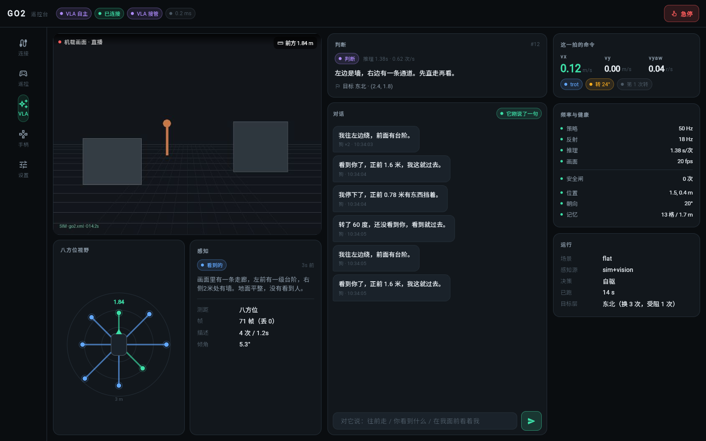
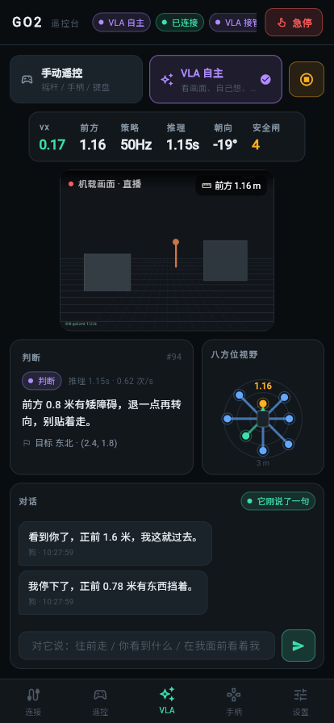
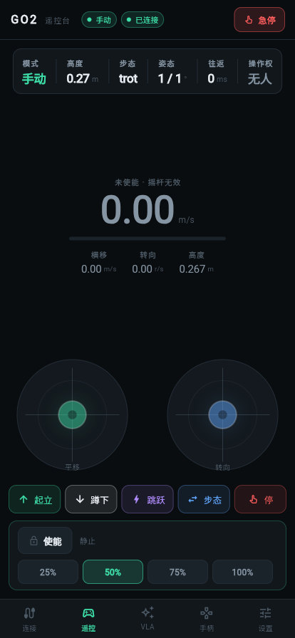

# Flutter 客户端与网关

手机 / 桌面 / 网页三端共用一个 Flutter 客户端，客户端连的是新加的
`quadruped.comm.gateway`（WebSocket），不直接碰 DDS。

```
Flutter App ──ws://──> gateway ──unix socket──> comm.server ──DDS──> 机器狗
                         │
                         └── 子进程 ──> vla（PolicyBackend 直连 rt/lowcmd）
```

## 为什么中间要加一层

`comm/server.py` 是单客户端：第二个连接直接回 409。手机、平板、桌面同时看的时候
这条规则把人挡在门外，而遥控本来就需要「一个能动的 + 若干个只能看的」。

网关解决三件事：

1. **多路复用**：一条到机器人的连接，扇出给 N 个 App。只有持有操作权的那个能发
   速度指令，其余只读。
2. **模式闸门**：手动遥控与 VLA 自主互斥。`rt/lowcmd` 同一时刻只能有一个发送者，
   切模式时必须先把一方 park 掉、再把控制权交给另一方。
3. **VLA 托管**：起停 VLA 子进程、转发人说的一句话、把事件和画面转给 App。

## 启动

```sh
# 仿真（机器人那台机器上）
uv run python -m quadruped.comm.gateway --preset sim

# 真机，手机要连进来
uv run python -m quadruped.comm.gateway --preset real --host 0.0.0.0 --token 123456

# 已经手动起了 comm.server，只想接上去
uv run python -m quadruped.comm.gateway --robot attach
```

客户端：

```sh
cd flutter-client
flutter run -d macos      # 桌面
flutter run -d chrome     # 网页
flutter run -d <安卓设备>  # 手机
```

也可以带参数直接进某一页（网页刷新、发链接给别人都用得上）：

```
http://<网关主机>:8099/?host=192.168.123.1&port=8780&t=123456&tab=vla
```

`tab` 取值：`drive` / `vla` / `gamepad` / `settings`，不给就是连接页。
遥控页背景可以一起指定：`bg=camera|radar|none`、`bgsize=main|small`。

## 界面

宽屏（1440×900）：左列是它看到的世界，中列是决策与对话，右列是命令与健康度。



手机（414×896）：画面在上，判断与雷达并排，对话占下半屏。




## 报文

一条连接上只跑 JSON 文本帧（另有二进制帧专用于画面）。所有 `op` 都是小写。

### App → 网关

| op | 字段 | 说明 |
|---|---|---|
| `hello` | `token` `name` `proto` | 连接后第一帧。口令不对回 `error 401` 并断开 |
| `lease` | `action: acquire\|release` | 取/还操作权。被占用回 409 和占用者名字 |
| `setpoint` | `vx` `vy` `vyaw` `source` | 速度设定值。只接受操作权持有者，20 Hz 发 |
| `cmd` | `cmd` `args` | `stand / uncrouch / crouch / stop / freeze / jump / gait / move` |
| `mode` | `mode: manual\|vla\|off` | 切模式。立刻回 `switching`，进度靠状态帧和事件 |
| `vla` | `action: start\|stop` | 停止 VLA（等价于切 `off`） |
| `say` | `text` | 人对 VLA 说一句话（写进它的 stdin） |
| `camera` | `on` | 是否接收画面 |
| `log` | `n` | 取 VLA 最近 n 行日志 |
| `ping` | `ts` | 心跳。App 每 2 秒发一次 |

### 网关 → App

| op | 内容 |
|---|---|
| `welcome` | 上限、当前模式、VLA 状态、最近一帧 VLA 事件、对话历史 |
| `state` | 10 Hz：`mode`、`lease`、`link`、`robot`、`input`、`vla`、`limits` |
| `vla` | 5 Hz：VLA 事件帧（见下表） |
| `ack` | 请求应答，`id` 原样带回 |
| `event` | `kind: mode\|lease\|error\|note`，一句话 |
| 二进制帧 | 1 字节来源（`1`=VLA 渲染窗口，`2`=机载相机）+ JPEG，5–8 Hz |

### VLA 事件帧（`runner.py` 的 `sink.publish`）

| 字段 | 含义 |
|---|---|
| `cmd.{vx,vy,vyaw}` `gait` | 这一拍下发的命令 |
| `sectors[]` | 八方位最近障碍（`name` / `gap` / `top`），`front_gap` 是正前 |
| `scene_text` `scene_age` | 视觉模型对画面的描述，以及它有多旧 |
| `thought` `reply` `reply_seq` | 这一轮的判断、对用户说的话、回话序号 |
| `guard.{trips,last}` | 安全闸触发次数与最后一次原因 |
| `policy_hz` `reflex_hz` `gen_s` `view_fps` | 策略 / 反射回路 / 单次推理 / 渲染频率 |
| `pos` `yaw_deg` `tilt_deg` | 位移（真机接管后为 null）、朝向、倾角 |
| `vision.{frames,dropped,views}` | 收图、丢帧、视觉描述次数 |
| `alert` | 安全闸正在介入 |

字段改动要两边一起改：`quadruped/control/embodied/runner.py` 与
`flutter-client/lib/core/models.dart`。

## 画面从哪来

两个源，一个出口。网关按当前模式选：

| 模式 | 画面 | 谁在取 |
|---|---|---|
| 手动 | 纯相机图（`FRAME_CAM`） | `percept.feed` 子进程，网关在切手动时拉起 |
| VLA | VLA 渲染窗口，带想法字幕和视野条（`FRAME_VLA`） | VLA 自己（`--stream`） |

第一字节标明来源，App 在画面角上标出来。**这张图不能当实景判断**：VLA 那张是
渲过的合成图，字幕压着画面底部。

手动模式之所以要单起一个进程取相机：`ChannelFactoryInitialize` 一进程一次，
相机和控制链路挤在一起，谁先初始化另一条就被绑在那套 domain/网卡上，而且不报错。
详见 `docs/control-ownership.md`。

## 模式状态机

```
off ──切手动──> 起 comm.server（或接已有的）──> manual
manual ──切 VLA──> park（停步→蹲下→阻尼→服务端退出）──> vla
vla ──切手动──> SIGINT 给 VLA（等 25 s 收尾）──> manual
manual|vla ──收工──> off
```

切换期间 `mode = switching`，`note` 写正在做什么。App 这两个按钮不是选项卡，
是交接控制权。

`park` 之后机器人是蹲下 + 阻尼的状态。VLA 起来时 `PolicyBackend` 会自己站回来，
手动模式则靠 `comm.server` 的 `ensure_standing()`。

## 三条安全阀

1. **操作权**：同一时刻只有一个 App 能发速度。别人要控制得先请求，被拒时看到的是
   「iPhone 正在控制」。
2. **设定值过期**：250 ms 内没收到新的设定值就发零速 + `stop`。手机锁屏、WiFi 断、
   进程被杀，最坏结果是停下。
3. **断线即停**：持有操作权的客户端断开，立刻停车并释放操作权。

App 侧还有一层：**使能开关默认关**。摇杆随便推，没使能一个字节都不发；
模式或操作权一变，自动解除使能并补一帧零速。

## 手柄

物理手柄接在跑 App 的那台设备上，经 `gamepads` 包归一化成统一轴/键，再走同一套
`ControlIntent` 抽象层，最后由网关转给机器人。手柄只负责产生「意图」，不直接产生
DDS 报文。

| 输入 | 动作 |
|---|---|
| 左摇杆 | 平移（前后 / 左右） |
| 右摇杆横向 | 转向 |
| A / B / X / Y | 跳跃 / 急停 / 蹲下 / 换步态 |
| Start | 使能开关 |
| 十字键 ↑ / ← → | 起立 / 速度档减增 |
| 键盘 WASD·QE·空格·Esc | 平移转向 / 跳跃 / 急停 |

安卓需要在 `MainActivity` 里把 `KeyEvent` / `MotionEvent` 转给插件（已改好）。
iOS 走 `GCController`，只认标准布局的手柄。Web 要用户先按一下手柄，浏览器才会
把设备交给页面。

**别和仿真器自带的手柄同时用。** `unitree_mujoco` 里也有一套手柄（发布
`rt/wireless_controller`），两条链路同时下指令会互相覆盖。

## 控制权

谁能让狗动、谁能只看、每条边界由哪条规则检查，都在
[`control-ownership.md`](control-ownership.md)。

## 校验

```sh
uv run python test/gateway_check.py     # 33 项：帧编解码、租约、模式闸门、过期停车
uv run python test/arch_check.py        # 通讯层只准模块级 import 标准库
cd flutter-client
flutter analyze
flutter test                            # 报文解析、手感曲线、摇杆符号
```

`test/ui_seed.py` 是联调用的假后端：假机器狗 + 假 VLA + 合成画面，让界面在不开
MuJoCo、不加载模型的情况下有数据可看。

```sh
uv run python test/ui_seed.py --port 8780 --token demo
# 浏览器打开 http://127.0.0.1:<静态服务器>/?host=127.0.0.1&port=8780&t=demo&tab=vla
```

## 这一层不做什么

- 不转发 `forward` / `turn`：那是阻塞调用，几秒内会卡住状态轮询。
- 不转发 `park`：那是网关自己的生命周期，不该由手机决定。
- 不做规划、不排队、不改速度指令的语义，只做上下限夹取（复用 `quadruped.limits`）。
- 不支持 TLS。局域网内用；要跨网就套一层 SSH 隧道或反代，别把 `8780` 暴露到公网。
