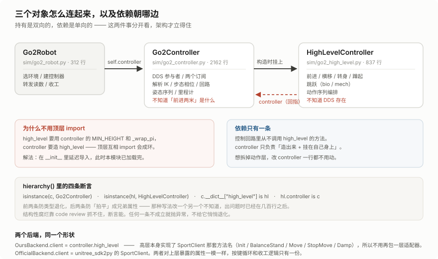
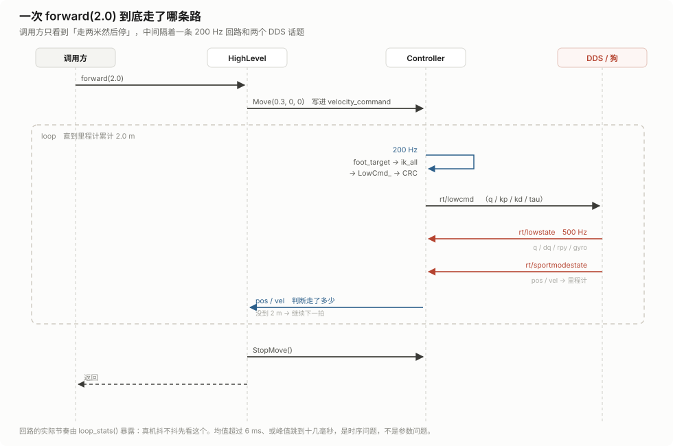
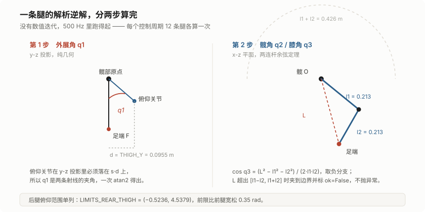
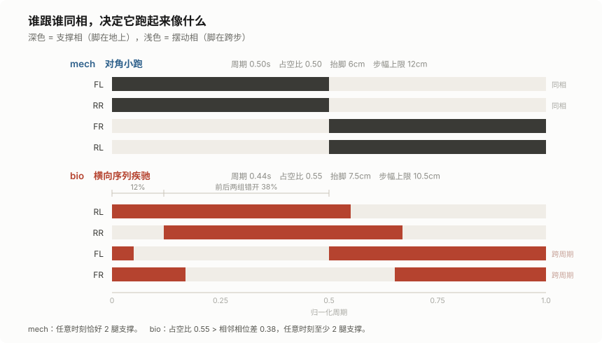
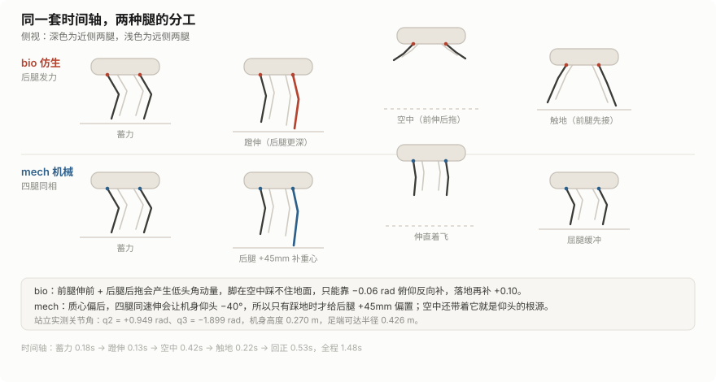

四足机器人能做什么，取决于你能碰到哪一层。

Go2 出厂带一套运动服务，39 个 RPC，调 `Move(0.3, 0, 0)` 它就往前走。这套东西能覆盖巡检、跟随、遥控，但动作集合是封闭的，反馈也是封闭的。想让它跳一下、想改步态、想按足端力判断打滑，都得自己往下走一层。

往下那一层是 `rt/lowcmd`：500 Hz、12 个关节、每个关节 `q / dq / kp / kd / tau` 五个字段。SDK 在这层只负责传输，逆解、相位、反馈、保护全归你。

这个项目做的就是这件事。代码约 5100 行，分五个模块，仿真和真机共用同一份控制代码。

## 一、官方接口的天花板

`SportClient.Move()` 背后是 `rt/api/sport/request` 上的一条 JSON 请求。狗内部的原生运控接住它、自己闭环、自己迈腿。你只给目标速度，剩下什么都不归你管。

两个限制随之而来。

**动作集合封闭。** 39 个 `apiId` 之外的东西没有。斜着跳一下、三条腿站住、落地时往前滑半步——都得自己实现。

**反馈也封闭。** `rt/sportmodestate` 给位置、速度、姿态、步态类型，够做导航，不够做控制。你拿不到每个关节在干什么，也就没法插自己的控制律。

低层是另一回事。`rt/lowcmd` 上跑的是 `LowCmd_`，一次发 12 组：

```python
for i in range(12):
    cmd.motor_cmd[i].q   = q_target[i]
    cmd.motor_cmd[i].dq  = 0.0
    cmd.motor_cmd[i].kp  = 120.0
    cmd.motor_cmd[i].kd  = 2.5
    cmd.motor_cmd[i].tau = tau_ff[i]
cmd.crc = crc.Crc(cmd)
pub.Write(cmd)
```

每 2 ms 一次。算错了狗就摔，摔之前不会有任何提示。

## 二、各目录管什么

```
main.py                              项目入口：问你要跑哪个控制器
quadruped/
├── control/                        控制算法，除了 DDS 不碰任何 IO
│   ├── controller.py       3015 行  低层：运动学、IK、步态、力矩、200 Hz 回路
│   ├── high_level.py        837 行  高层：动作编排，跳跃在这里
│   ├── virtual/                     抽象层：控制器协议 + 机器人对接，不上菜单
│   │   ├── protocol.py      133 行   ControllerModule / GROUP 校验
│   │   ├── robot.py         264 行   端点解析、控制端选择、connect() 工厂
│   │   └── backends.py      226 行   两个控制端实现（唯一 import SDK 的地方）
│   ├── physical/                    物理控制器：直接驱动机器人
│   │   └── keyboard.py     1018 行  键盘遥控，只调抽象层那四个函数
│   └── embodied/                    具身智能控制器：决策层，暂时留空
├── robot/
│   └── body.py              314 行  本体层，唯一对外入口
├── cli/
│   ├── main.py              236 行  命令行入口（stand / trot / act …）
│   └── launcher.py          284 行  控制器菜单与进程管理
└── sim/                             仿真资产（不是 Python 包）
    ├── run_sim.sh                   mjpython 外壳
    └── unitree_mujoco/              官方仿真器（子模块，未改动）
test/                                DDS 探测、真机诊断、速度实测
docs/
└── gen_figures.py                   博文配图与视频的生成脚本
```

启动器不登记任何分组：它扫 `control/` 下的子包，谁在自己的 `__init__.py` 里写了 `GROUP` 谁就上菜单，标题和顺序也归那个目录自己管。加一个分组不用碰任何中心文件。

控制器不 import 本体层也不 import SDK：接哪台、怎么连由 `control/virtual/robot.py` 决定，真接上之后怎么驱由 `backends.py` 负责。物理控制器只写「按下 w 就走 0.3 m/s」。

按职责分层而不是按代码行数：`control/` 是可以脱离机器人单独跑（`selftest` 就是这么跑的），`robot/` 只做装配和转发，`cli/` 只解析参数，`sim/` 是外部资产。

分工按"改动频率"切，不按代码行数切。

`control/controller.py` 占了一半体量，因为所有会变的东西都在这里：关节几何、限位、步态参数、反馈增益、DDS 通信。`control/high_level.py` 只描述动作，改一个跳跃节奏不用碰控制回路。`robot/body.py` 三百行，几乎不随算法改动。

## 三、三层对象：持有双向，依赖单向

对外只有一个入口：

```python
robot = Go2Robot(iface="en5")
robot.controller.high_level.forward(2.0)
```

里面是真嵌套：

```
Go2Robot
└─ controller      Go2Controller
   └─ high_level   HighLevelController
```



职责切得很硬。

`Go2Robot` 不写算法。它只做四件事：按网卡选环境、造控制器、转发传感器读数、收工停机。`PRESETS` 里只有两个常量表，一行控制律都没有。

`Go2Controller` 管 2 ms 的回路。DDS 参与者、解析 IK、步态相位、重力前馈、里程计全在这一层。它不知道"前进两米"是什么意思，只认速度指令和足端目标。

`HighLevelController` 只管动作。`forward(2.0)` 被拆成"发速度指令 → 等里程计走到 2 米 → 停"，`jump()` 被拆成一串足端目标交给回路去播。它不知道 DDS 存在，所以仿真和真机跑的是同一份代码。

### 那个循环 import

`high_level` 要用 `controller` 的 `MIN_HEIGHT` 和 `_wrap_pi`，`controller` 要造 `high_level` 挂在自己身上。顶层互相 import 会成环。

解法是在 `__init__` 里延迟导入：

```python
def __init__(self, ...):
    ...
    from quadruped.control.high_level import HighLevelController
    self.high_level = HighLevelController(self)
```

构造 `Go2Controller` 的时候，本模块已经加载完，这时 import 不会再触发环。

关键在于：`controller` 只负责"造出来 + 挂上"，控制回路里从不调用它的方法。依赖是单向的，高层依赖控制器，反过来不成立。想拆掉动作层，控制回路一行都不用改。

### 四条断言

`hierarchy()` 里放了四个检查：

```python
assert isinstance(c, Go2Controller), "第 2 层不是 Go2Controller"
assert isinstance(hl, HighLevelController), "第 3 层不是 HighLevelController"
assert c.__dict__.get("high_level") is hl, "high_level 不在 controller 上"
assert hl.controller is c, "high_level 没有指回它的父对象"
```

前两条防类型退化，后两条防"拍平"——把 `high_level` 抄一份挂到 robot 上做成兄弟属性。那种写法看起来能用，实际改一个另一个不知道，等发现问题时已经在几百行之后。结构性腐烂靠 code review 抓不住，断言能。

## 四、一次 forward(2.0) 走哪条路



调用方看到的是一条直线：进去，等两米，出来。中间实际发生的：

1. `HighLevelController.forward()` 调 `Move(0.3, 0, 0)`，把速度写进控制器
2. 控制器回路以 200 Hz 跑：算足端目标 → 解析 IK → 组装 `LowCmd_` → 算 CRC → `Write`
3. 狗或仿真器以 500 Hz 发 `rt/lowstate`，回调更新 `q / dq / rpy / gyro`
4. `rt/sportmodestate` 更新 `pos / vel`，里程计按 `pos` 差分累计距离
5. 高层每拍读一次 `pos`，没到 2 米就继续，到了就 `StopMove()`

两件事值得单独说。

**回路频率是 200 Hz，不是 500。** 协议要求 500 Hz 发指令，但控制律不需要跑那么快——足端轨迹是连续的，200 Hz 的离散误差在 1 cm 以内。真要 500 就改 `_ensure_loop` 里的周期，代价是 Python 的 GIL 压力。

**回路节奏用 `loop_stats()` 暴露出来。**

```python
st = self.robot.controller.loop_stats()
# mean 5.0, max 6.2  →  正常
# mean 8.5, max 21.0 →  时序问题，不是参数问题
```

真机抖的时候先看这个数，再决定要不要动 `kp`。均值超 6 ms 或峰值跳到十几毫秒，说明有东西在抢 GIL（打印、文件写入、`cv2.imdecode`），调参数是白费。

## 五、两个后端，同一个形状

`control/physical/keyboard.py` 里有两个控制端，对上层暴露的属性完全一样：

```python
class OursBackend:
    kind = "ours"
    label = "自研控制器 HighLevelController"

    def __init__(self, preset, domain, iface):
        self.robot = Go2Robot(preset, domain=domain, iface=iface, ...)
        if not self.robot.connect():
            raise RuntimeError("3 秒内没收到 rt/lowstate")
        self.client = self.robot.controller.high_level
```

`self.client` 直接就是高层对象，没有适配器。因为 `HighLevelController` 从一开始就实现了 `SportClient` 那套方法名：`Init / SetTimeout / BalanceStand / Move / StopMove / Damp`。方法签名对齐，后端换起来只是改一个引用。

这个决定省掉不少代码。后面的连接、按键循环、速度限幅、收工逻辑各只有一份，不会出现"仿真里好好的、真机上另一个行为"。

代价是 `HighLevelController` 的方法名被官方 API 绑住了。可以接受，那套名字本来就是这个领域的通用词汇。

## 六、解析 IK：两步算完，不迭代

每条腿三个关节：外展（`hip`）、髋俯仰（`thigh`）、膝（`calf`）。给定足端在机体系的位置，反解三个角。

500 Hz × 4 条腿 = 每秒 2000 次求解。数值迭代也能算，但这条腿有闭式解，两连杆而已。

**第一步，外展角。** 约束是硬件的：俯仰关节在 y-z 投影里必须落在 `s·d` 上，`d = THIGH_Y = 0.0955 m`，`s` 是左右腿的符号。足端方向和俯仰关节方向定了两条射线，`q1` 是它们的夹角：

```python
ryz2 = py*py + pz*pz
vz = -math.sqrt(ryz2 - d*d)          # 取向下的一支
q1 = _wrap_pi(math.atan2(pz, py) - math.atan2(vz, s*d))
```

`ryz2 < d*d` 直接返回失败。足端比髋部原点的侧向偏移还近，几何上要求腿穿过机身，无解。

**第二步，俯仰平面内解两连杆。** 大腿小腿各 0.213 m：

```python
cos_q3 = (L*L - l1*l1 - l2*l2) / (2*l1*l2)
cos_q3 = max(-1.0, min(1.0, cos_q3))
q3 = -math.acos(cos_q3)              # 屈膝，取负分支
```



三处细节。

**取负分支。** 膝关节范围全在负半轴。`+acos` 解出来是反关节，膝盖朝前弯，狗的腿没有那个自由度。

**`atan2` 里的符号。** `phi_thigh = atan2(px2, -pz2)`，两个 `-pz` 不能写成 `pz`。写成正的也能算出一个角，只是整个膝关节镜像了。仿真里一眼能看出来，真机上是一声闷响。

**越界不抛异常。**

```
腿长越界 L=0.4300 ∉ [0.0000, 0.4260]
```

`clamp=True` 把目标缩到边界，返回 `ok=False` 和具体原因。2 ms 的循环里抛异常等于把控制线程停掉，画图、记录、继续跑都更有用。

后腿的俯仰前限单列了一条：`LIMITS_REAR_THIGH = (-0.5236, 4.5379)`，比前腿宽松 0.35 rad。髋部几何不同，同一条腿往前伸，后腿能到的角度前腿到不了。

## 七、步态：相位决定气质

足端轨迹由一个归一化相位决定：

```python
ph = (t / period + offsets[leg]) % 1.0
```

`offsets` 是唯一的形态参数。改它，狗从机器变成动物。



**mech（对角小跑）**：`FL` 和 `RR` 同相，`FR` 和 `RL` 同相，两组差半个周期，占空比 0.5。任何时刻恰好两条腿着地。

**bio（横向序列疾驰）**：`RL 0.00 → RR 0.12 → FL 0.50 → FR 0.62`，相邻错 12%，前后两组错 38%，占空比 0.55。

不用 bound（前后两组同时起落），因为 bound 两组之间必然留出腾空。那一瞬间机身完全没有支撑，落地又是两条腿一起砸。横向序列四腿错开，支撑力连续，落地是单腿轻接。

占空比 0.55 大于相邻相位差 0.38，这条不等式保证任何时刻至少两条腿在地上。

支撑相和摆动相走完全不同的逻辑。

**支撑相**匀速后扫：

```python
s = ph / gp.duty                 # 0→1
f = 0.5 - s                      # +0.5 → -0.5
x = nx + 2.0 * dx * f
```

竖直方向刻意压下去 `stance_sink`（6 mm）。位置控制下"刚好贴地"等于"时接时离"——机身一抬头脚就悬空，没有法向力就没有摩擦，脚只会在原地打滑蹭出噪声。压 6 mm 换来稳定支撑，代价是机身低一点点。

**摆动相**走四次多项式：

```python
c = a3 * s**3 + a4 * s**4
```

系数由占空比解出来，约束是两端的位置、速度、加速度都为零：

```
f(0) = f'(0) = f''(0) = 0,  f(1) = 1,  f'(1) = -(1-duty)/duty
⟹  a3 = 4 - u,  a4 = u - 3,  u = -(1-duty)/duty
```

`sin` 曲线也能跨步，但落地瞬间速度不为零，脚是拍在地上的，那一下冲击全靠 `kd` 吸收。

两段视频都是 MuJoCo 里真跑物理的结果，PD 跟踪控制器算出的关节角：

<video controls muted loop playsinline poster="./img/sim-stand.png" src="./img/sim-gait-mech.mp4"></video>

<video controls muted loop playsinline poster="./img/sim-stand.png" src="./img/sim-gait-bio.mp4"></video>

*上：mech 对角小跑。下：bio 横向序列疾驰。同一个 `foot_target`，只换了 `offsets` 和 `duty`。*

## 八、三个反馈，外加一个前馈

纯开环的位置控制在仿真里跑得起来，一加扰动就崩。每一项对应一类具体的崩法。

### 支撑相速度闭环

原来脚的后扫速度按指令开环算。机身一旦被扰动慢了，脚相对地面的滑动方向就反过来，摩擦从推力变成刹车，机身更慢，差更大。

实测：指令 `+0.45`，机身跑出 `−0.34`。倒着走。

改成看实测速度：

```python
v_scan = v_meas + k * (v_cmd - v_meas)
```

机身慢下来，误差项自动变大、脚扫得更狠，把机身推回去。跑到指令速度，误差项归零。

### 落点前移

`reach` 让整个足端轨迹沿 x 平移 `reach × 速度`。跑得越快，脚落得越靠前。机身越过支撑脚的过程中，支撑力把机身往前带。

配合 `reach_err` 做速度误差反馈：比指令快就把脚踩得更前（支撑力制动 + 抬头），比指令慢就少踩一点。Raibert 那套落脚点自稳。缺了它，跑起来会越跑越快或者前后晃。

### 竖直阻尼

四条腿撑在地上是一个弹簧。`kp 120`、单腿竖直刚度约 2500 N/m、两条腿撑 15 kg，固有频率 `sqrt(5000/15) ≈ 2.9 Hz`。步频 2.2 Hz——每一步落地都在共振点附近激一下，腿上只有 `kd 2.5` 那点阻尼。

实测 `0.55` 指令下，机身高度峰峰 83 mm、俯仰峰峰 36°。

`damp_z` 按机身竖直速度反向挪支撑脚：机身往上走就把脚往回收。系数 `0.03~0.05`，相当于给这个模态 `0.3~0.5` 的阻尼比。

### 重力前馈

`tau_ff` 按支撑腿分权重给前馈力矩。这里踩过一个坑，值得单独说。

竖直力必须按权重归一，总和恒等于体重。原来每条支撑腿固定给 `mg/4`。四条腿都在地上的站姿没问题，一进步态就出事——小跑任意时刻只有两条腿支撑，总前馈只剩 `mg/2`，另一半体重全靠 `kp` 的静差硬顶。腿被压弯到工作空间底、足端在地上拖。

真机化仿真实测：指令 `0.9` 只跑出 `0.10 m/s`，关掉前馈反而有 `0.29`。

分母还要夹一个下限 1.0，不能直接除 `Σw`：

```python
f_total = cls.LEG_WEIGHT_N * len(CTRL_LEGS)   # mg
wden = max(wsum, 1.0)
fz = -f_total * w / wden
```

换腿那一瞬间，旧腿的权重在往 0 掉、新腿的刚从 0 起，`Σw` 会掉到 0.1 以下。除下去等于把 `mg` 全压给一条刚沾地的腿，力矩瞬间顶满限幅，下一帧又掉回来。实测步态里 9.6% 的关节帧贴在 12 N·m 限幅上，机身高度峰峰 24 mm、角速度 rms 0.65 rad/s。

最后，符号是负的。足端几何里 `p_z` 向下为正，"把机身顶起来"对应 `f_z` 取负。静站实测：`tau_ff=+1.0` 机身沉 12 mm，`-1.0` 升 12 mm。正的等于四条腿一起把机身往地里压。

## 九、跳跃：两套物理

跳跃是一串足端目标，交给控制回路播，`jump_async()` 排完就返回。跳的同时还能按方向键、调速度、再跳一次。

时间轴固定：

```
蓄力 0.18s → 蹬伸 0.13s → 空中 0.42s → 触地 0.22s → 回正 0.53s
```

蹬伸拆成两段（0.07s + 0.06s），速度递增。位置伺服做跳，靠的是脚还踩着地面那一下把机身快速顶高。蹬伸必须在腿伸到极限之前结束，否则冲量全变成撞限位。



**bio 仿生，靠前后分工。**

后腿压得更深（`+0.07`），前腿也蹬但蹬得少（`+0.020`）。前腿不能不出力——前端一悬空，机身在尾部支撑下立刻前栽。实测 `front_h=0` 时 pitch 到 `+32°`，脸朝下。

离地后前足往机身前方送 `0.09`，后足往后拖 `0.045`，落地那下前腿先够到地面接住机身。

代价是这套伸展给机身一个低头角动量，脚在空中又踩不住地面。所以空中给 `−0.06 rad` 俯仰反向补，触地再补 `+0.10`，把落地俯仰从 `−29°~+15°` 收到 `±4°`。

**mech 机械，靠四腿同步。**

四条腿一个相位，一起伸一起收。推力是仿生的两倍，而 Go2 质心偏后——同样蹬 `0.07` 会直接后空翻。实测离地 `+0.29 m`、pitch `−89°`。所以蹬伸量单独压到 `0.025`。

也不能真的四条腿完全一样。前腿负载轻、先离地，四腿同速伸等于只用后腿顶，机身照样仰头，实测 `−40°`。所以踩地时给后腿多 `45 mm` 补偿。

关键在"只在踩地时给"。悬空时这点偏置会变成后腿多伸的仰头力矩，带进空中就是落地仰头的根源。

下面这段是仿真里跑出来的：

<video controls muted loop playsinline poster="./img/sim-air.png" src="./img/sim-jump.mp4"></video>

*从 0.27 m 站姿起跳，峰值 0.423 m，落回 0.262 m 站住，落地俯仰 +0.1°。这一条把蹬伸目标提到 0.335——默认的 0.265 在仿真里只离地 4.7 cm，看不出跳跃。*

*动力学全部由 MuJoCo 算：重力、地面接触、足端冲量。控制器只输出 12 个目标关节角，力矩是 `kp*(q_des-q) - kd*dq`，kp 120 / kd 2.5，限幅 23.7 N·m。*

### 走着跳是另一套问题

速度不能用指令值。步态本身打滑，指令 `0.3` 时机身实际只有 `0.2` 出头，按指令算足端后退量会算过头，落地往前栽：

```python
mv = c.body_velocity()
if mv is not None and abs(mv[0]) + abs(mv[1]) > 0.02:
    cvx, cvy = mv[0], mv[1]
```

更麻烦的是"起跳把速度吃掉"。机身在地上以 `v` 前进，脚在机体系里就必须以 `v` 后退，否则脚一踩实就把机身拽停。整条序列按时间积分出一个累计后退量：

```
地面段   0 → 离地       以 v × 1.5 后退
空中段   离地 → 触地     收到机身前方 3 cm
触地段   再往后扫 v × 0.12
```

系数 1.5 是实测的。等于 1.0 的话脚只是跟着地面走，一点推力都不给。

还有一处：走着跳时"前腿伸前"要收着点（`JUMP_REACH_FADE = 0.30`）。那套伸展是给原地跳准备的，机身带着速度前进时脚再往前伸一大截，落地等于在重心前面插了一根撑杆。实测落地瞬间 `−0.95 m/s`。

## 十、环境隔离：网卡选，域号定

原来有个 `--sim` 开关。忘了加就连真机，加错了连不上又查半天——两个错误的现象一模一样：收不到数据。

现在看网卡：

```python
robot = Go2Robot()                 # 不给参数 = 仿真
robot = Go2Robot(iface="lo0")      # 回环 = 仿真
robot = Go2Robot(iface="en5")      # 非回环 = 真机
```

判定规则在 `resolve()`，但真正的依据是域号：仿真器发布在 `simulate_python/config.py` 的 `DOMAIN_ID`（默认 1），真机固定在 domain 0。

RTPS 端口按 `7400 + 250 × domain` 分配。域号不同就是两套独立的网，同一台电脑同时连着真机和仿真器也不会串台。

代码直接读仿真器那个 `config.py`：

```python
m = re.search(r"^\s*DOMAIN_ID\s*=\s*(\d+)", text, re.M)
```

谁把仿真器改到 en0、或者把域号换成 3，控制端不用改代码。

顺着这条线还有一个结论：**仿真环境不能列官方客户端**。

```python
CLIENTS = {
    "sim": ("ours",),
    "real": ("official", "ours"),
}
```

仿真桥只转发 `rt/lowcmd` 和 `rt/sportmodestate`，没有 `rt/api/sport/request` 的服务端。官方 `SportClient` 发过去会一直等到超时，返回 3102。所以仿真菜单里根本不列这一项。

## 十一、仿真和真机之间，哪些数能搬

**形态参数能搬，幅度参数不能。**

相位、周期、占空比这些描述"怎么迈腿"的量，仿真的值直接搬到真机。描述"用多大力"的量——步幅、抬脚高度、压地量——单独一档：

```python
if real:
    return GaitParams(period=0.45, stride_max=0.10, speed_loop=1.5,
                      stance_sink=0.004, swing_height=0.09,
                      speed_range=(0.0, 0.55))
```

仿真里打滑是"损失"，真机上打滑是"整条腿在地上刨，一步都走不动"。抬脚也一样：真机足端有橡胶、地面软，6 cm 的余量经常蹭地，改成 9 cm。

**控制参数默认不按环境分叉。**

`Go2Robot` 里 `real_params` 默认 `True`，仿真也用真机那一套 `kp/kd`。因为仿真器已经把关节摩擦、力带宽、编码器噪声、指令延迟都建进去了。再给仿真单独调一套软的，等于对着一个不存在的理想模型调参。

"仿真调好一上机就抖"、"仿真里能跑 0.35、真机一步都不走"，都是这么来的。

想对照理想模型时显式传 `real_params=False`。那是调试用的旁路，不是日常默认。

**仿生档把姿态反馈全关了。**

```python
pitch_gain=0.0, pitch_rate=0.0, roll_gain=0.0, roll_rate=0.0,
```

看着反常。原因是四腿错相时，俯仰/滚转修正会落到正在摆动的那条腿上——那条腿在空中，修正等于零，落地还砸得更重。实测加上去之后，从"能跑"变成"翻"，roll 转了 180°。

**速度闭环只对仿生档加强。** 同一个配置反复跑，`speed_loop=1.2` 会在 `0.14` 和 `0.41` 两个吸引子之间跳；改到 1.5 之后四次都落在 `0.35~0.40`。四腿错相时支撑力在 1~2 条腿之间来回交班，闭环弱了跟不上。

## 十二、踩过的坑

按"现象 → 原因"排：

| 现象 | 原因 |
|---|---|
| 指令 `+0.45` 跑出 `−0.34` | 支撑相开环算后扫速度，扰动让摩擦方向反了，正反馈倒退 |
| 指令 `0.9` 只跑出 `0.10` | 重力前馈按 `mg/4` 固定给，两条腿支撑时只剩 `mg/2` |
| 机身一直在颤（峰峰 24 mm） | 换腿瞬间 `Σw→0`，前馈除出力矩尖峰，9.6% 的帧贴限幅 |
| 步幅放到 0.12 速度还是上不去 | 重力前馈符号反了，四条腿在把机身往地里压 |
| 仿生档一跑就翻（roll 180°） | 姿态修正落到摆动腿上，做负功 |
| 同一配置在两个速度间跳 | 仿生档速度闭环太弱，1.2 → 1.5 |
| 四腿蹬 0.07 会后空翻（pitch −89°） | 质心偏后，机械步态推力是仿生两倍 |
| 机械步态仰头 −40° | 四腿同速伸，前腿先离地，只剩后腿顶 |
| 落地瞬间 −0.95 m/s | 脚还没碰地就被收回中立位，机身从半空砸下来 |
| 原地起跳退后 15 cm | 前腿前送 + 后腿后拖的净反作用把机身往后推 |

## 十三、怎么跑

仿真器是 `unitree_mujoco`，用 `mjpython` 启动：

```bash
./quadruped/sim/run_sim.sh              # 默认 go2
./quadruped/sim/run_sim.sh b2           # 换机器人
```

必须用 `mjpython`：macOS 要求 GUI 跑在主线程，`mujoco.viewer.launch_passive()` 在普通 `python` 下直接崩。也必须 `cd` 到 `simulate_python`，`config.py` 里的模型路径是相对的。

另一个终端跑控制：

```bash
.venv/bin/python quadruped/cli/main.py stand
.venv/bin/python quadruped/cli/main.py forward 1.0
.venv/bin/python quadruped/cli/main.py trot --vx 0.3 --duration 8
```

键盘遥控是同一份代码，网卡就是开关：

```bash
uv run python main.py                             # 问你要跑哪个控制器
uv run python main.py keyboard -- --iface en5     # 直接跑键盘遥控，真机
uv run python main.py keyboard -- --dry-run       # 只打印速度，不连狗
```

按键：`w/s` 前后、`a/d` 横移、`q/e` 转向、空格跳跃、Ctrl 蹲起、Enter 停车、`1..9` 速度档。

上面所有图和视频都能自己重出：

```bash
.venv/bin/python docs/gen_figures.py still   # 三张姿态图
.venv/bin/python docs/gen_figures.py gait    # 两段步态视频
.venv/bin/python docs/gen_figures.py jump    # 跳跃视频
```

---

现在的状态：仿真里能站、能跑、能跳，两条步态都稳定。真机还没接上——网线那头一直没通，所有画面都是仿真。

下一步想把 `rt/lowstate` 里的足端力读出来，替换掉现在用位置估的接触判断。现在腾空/着地全靠相位推算，踩到东西或者地面不平就会误判，`stance_sink` 那 6 mm 就是为了在这种不确定性下硬撑住。
