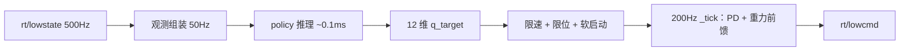

开工之前先摆清楚位置：控制器里到现在没有一行学习代码，`pyproject.toml` 里只有 osqp、pynput 和 unitree-sdk2py。下面写的是从零加一条强化学习支线，每一步落在哪个文件、拿什么验收、哪里会翻车。这些判断都能被代码和数据推翻，欢迎照着挑。

## 一、手写步态的天花板在哪

控制器是相位驱动的：一个周期里每腿有支撑相和摆动相，支撑相足端按速度反向平移，摆动相走一条「快抬慢落」的曲线，足端目标经 IK 变成 12 个关节角，加 PD 和重力前馈发到 `rt/lowcmd`。参数靠人扫，`mech`、`bio`、`gallop` 三套就是这么调出来的。

仿真里的实测边界：

| 条件 | 结果 |
|---|---|
| 0.20 m/s 平地 | 10 s 稳，pitch −2°、roll ±1°、dy ±1 cm |
| 0.30 m/s 平地 | 约 5 s 后失速，vt 0.23 → 0.00，打滑累积 |
| 5° 横坡 | 8 s 不翻，横移 94 cm，roll 峰峰 31° |

三件事一直没解决：高速打滑、横坡持续往坡下漂、法向力分配全靠支撑权重凑。它们有一个共同点——都发生在接触面上。接触模型做不准，调参数就只能靠试。

强化学习能覆盖这一段。它可以在几千万次试错里，把「什么相位配什么足端速度、什么姿态该往哪压」摸出来。代价是三样：得建训练环境、得防 sim2real 的坑、得接受训出来的东西不一定比手写的稳。

所以先分开问：你要的是运动，还是控制律。

## 二、两个问题其实是两级

「拿到新步态或新动作」要的是**运动本身**。它可以只是一组参数，或者一条时间轨迹，不需要神经网络上机。

「生成小脑权重，用推理操控机器人」要的是**控制律**。一个网络吃观测、吐关节目标，顶掉的正是现在 `_gait_feet_publish` 加 IK 加前馈这一整条链。

第二级包含第一级。先做第一级，一周内能拿到和现有步态直接对比的结果，而且随时可以 git revert。

## 三、训练环境不能接现有那条 DDS 链路

现在的仿真是一个独立进程跑 mjpython，控制器在另一个进程，中间走 DDS。控制回路 200 Hz，一帧 5 ms。强化学习要跑一亿步量级，这个吞吐差三个数量级。

训练环境必须进进程内：`mujoco.MjModel` 直接读 `go2.xml`，自己推进物理。新建 `quadruped/rl/env.py`，和 `controller.py` 不互相 import。

三条硬约束，写在最前面免得后面返工。

**模型只有一份。** 训练吃 `quadruped/sim/unitree_mujoco/unitree_robots/go2/go2.xml`，就是 `model.py` 拿来做 RNEA 校验的那份。别为了迁到别的训练框架转一版 URDF——质量差 1 kg，重力前馈差 10 N，仿真里看不出来，上机就是腿软。

**顺序合同写在一处。** 这个项目里关节顺序有三个来源：`CTRL_LEGS`（xml 的 actuator 顺序，FR、FL、RR、RL）、`LEGS`（几何顺序 FL、FR、RL、RR）、`MOTOR_LEGS`（同 FR 开头）。训练侧的观测拼接、动作还原、部署侧的观测组装，全部 import 同一份 `spec.py`，不许各自写一遍。

**观测不用 rpy。** 用重力在机体系的投影，横滚接近 ±90° 时不会跳变。姿态可以用，但别把欧拉角塞进网络。

`spec.py` 大概长这样：

```python
# quadruped/rl/spec.py —— 观测与动作的定义只有这一份
OBS_ITEMS = (
    ("gyro",      3, 0.25),   # 机体系角速度 rad/s
    ("grav",      3, 1.00),   # R^T · [0,0,-1]
    ("cmd",       3, 1.00),   # vx, vy, wz
    ("q_err",    12, 1.00),   # q - STAND_Q，顺序 CTRL_LEGS
    ("dq",       12, 0.05),
    ("act_prev", 12, 1.00),   # 上一帧动作，压抖动
)
HIST = 5                                  # 堆 5 帧，对抗延迟
OBS_DIM = sum(n for _, n, _ in OBS_ITEMS) * HIST   # 45 × 5 = 225

ACTION_SCALE = 0.25                       # q_target = STAND_Q + 0.25 · a
CTRL_DT = 0.02                            # policy 50 Hz
PHYS_DT = 0.002                           # 物理 500 Hz，decimation 10
```

执行器在训练环境里要自己实现，别直接用 xml 的 position actuator：

```python
tau = kp * (q_des - q) + kd * (0.0 - dq)      # kp=100, kd=1.5，与真机同源
data.ctrl[:] = tau
```

`kp=100 / kd=1.5` 是这套机器实测出来的（`KP_REAL` / `KD_REAL`）。换成其他教程里常见的 20 / 0.5，训出来的策略是在对付一双根本不存在的软腿：仿真里站得稳，上机抬不起脚。

## 四、路线 A：让 RL 去搜步态参数

第一周不碰神经网络。动作空间就 8 个数：周期、占空比、抬脚高度、最大步幅、站宽、四腿相位偏移、抬脚曲线形状。内部照样走 `foot_target()` → `ik_leg()` → PD + 前馈，一行控制代码都不改。

八个数的搜索空间，用 CMA-ES 或者 PPO 都行，十万到百万步能收敛，一台 Mac 跑得完。产出是一行 `GaitParams`，`make_gait()` 直接吃，回归成本为零。

奖励这么写：

| 项 | 形式 | 权重 |
|---|---|---|
| 前进速度跟踪 | `exp(-(vx - vx_cmd)**2 / 0.04)` | 1.5 |
| 横向、偏航漂移 | `-(abs(vy) + abs(wz))` | 0.5 |
| 姿态 | `-(roll**2 + pitch**2)` | 0.6 |
| 机身高度 | `-(h - 0.27)**2 / 1e-3` | 0.3 |
| 足端打滑 | 支撑相足端水平速度平方 | 0.8 |
| 关节力矩 | `sum(abs(tau))` | 1e-3 |
| 力矩帧间差 | `sum(abs(tau_t - tau_prev))` | 1e-4 |

打滑项是重点。0.30 m/s 失速的链条是「打滑 → 速度环放大步幅 → 脚扫得更快 → 滑得更狠」，惩罚足端水平滑动会直接把这条正反馈掐掉。力矩帧间差这一项和 `_slew_tau` 里做的事一样，区别只是交给优化器自己找平衡。

验收直接用现有脚本：`test/gait_speed.py`，比位移、roll/pitch 峰峰、打滑率，跟 `mech`、`bio`、`gallop` 摆一起看。横坡那一组要单独跑，它现在横移 94 cm，任何改善都看得见。

这一步的产出不一定是「新步态」，可能只是一组更抗滑的参数。那也算赚：手扫 duty 和站宽是按天算的代价，搜索能把它压到小时。

## 五、路线 B：学一个会换步态的策略

真正的端到端策略，动作是 12 维关节目标。

观测 225 维，就是前面 `spec.py` 那六项堆 5 帧。动作 `a ∈ R¹²`，`q_target = STAND_Q + 0.25·a`，再 clip 到关节限位（后腿大腿用 `LIMITS_REAR_THIGH`，前限更松）。

奖励在路线 A 的基础上加两样。

**抬脚。** 只给前进奖励，策略会学出「蹭地拖行」——脚不离地，靠摩擦往前挪，速度指标能过，姿态一塌糊涂。加摆动相足端离地高度、腾空时间，把脚逼起来。

**接触序列。** 想让它出指定步态，就把目标接触相位喂进奖励：

```python
r_contact = -sum(abs(c_i - c_hat_i) for i in range(4))
```

`c_hat` 由内时钟给：对角相位是 trot，前后两对是 bound，四腿错相是 gallop。同一套奖励换模板就换步态，跟你现在 `make_gait` 的三档一一对上。想让它自己发现步态，就把这一项删掉、只留抬脚约束，代价是收敛慢，也更容易落到奇怪的解上。

课程学习不能省：指令从 0 开始，能站住 5 s 再加 0.1 m/s；平地走稳了再加 ±2 cm 起伏和摩擦随机；最后加侧向推力。一步到位地训 0.6 m/s，前面几百万步全是摔。

**跳跃、后空翻这类动作另走一条路。** 从零搜奖励太贵，用参考轨迹加模仿奖励：`pose_sequence` 已经有关键帧插值，把关键帧扩成带时间戳的轨迹，网络学跟踪，落地缓冲单独给奖励。`peak_z` 是现成的高度量尺。

## 六、小脑上机：50 Hz 出目标，200 Hz 执行

部署时的数据流：



策略 50 Hz 出目标，200 Hz 回路只做插值、限速、PD 和前馈。三件事必须守住：

**推理不许进主回路。** `embodied/__init__.py` 里那句写得很准：一次推理几百毫秒，塞进回路就是丢帧、腿悬空。策略跑独立线程，`_tick` 读一个引用赋值的双缓冲，单写单读不需要锁。真要把策略放独立进程，`launcher.py` 的多进程模型现成就能用。

**软启动。** 从 `stand_q` 用 0.8 s 插值滑进策略输出。`_tau_ff` 里那段 `TAU_ARM_ERR` 斜降逻辑是同一个问题的手写版：实际角和目标差得远的时候，前馈必须退，否则腿朝莫名其妙的方向蹬一下。

**后置过滤。** 策略输出的目标先过三道：关节限位 clip、关节角每帧限速（0.05 rad/帧，200 Hz 下等于 10 rad/s）、力矩限幅。`selftest()` 那一套 `_check_*` 全部保留。

```python
# mode == "policy" 时 _tick 里做的事
tgt = self._policy_target if self._policy_target is not None else self._hold_q
tgt = np.clip(tgt, self._q_lo, self._q_hi)
tgt = self._slew_q(tgt, step=0.05)
self._publish(tgt, tau=self._tau_ff(tgt))
```

推理后端用 ONNX Runtime 就够。三层 256 的 MLP，前向 0.1 ms 以内，Go2 机载那点算力完全吃得下，瓶颈在 Python 的 GIL 和线程调度，不在网络本身。

权重文件里要存三样东西：`spec_hash`、`kp/kd`、`go2.xml` 的 hash。观测定义改一个字段，旧权重就该判废，别指望它还能用。

## 七、sim2real 清单

| 项 | 范围 | 说明 |
|---|---|---|
| 机身质量 | ±10% | 加负载、换电池都会变 |
| 地面摩擦 | 0.4 ～ 1.2 | 瓷砖、地毯、水泥差别很大 |
| 电机强度 | ±15% | 电池电压从 32 V 掉到 28 V |
| 控制延迟 | 1 ～ 3 帧 | DDS 加驱动器，按 5～15 ms 估 |
| IMU 噪声 | 陀螺 0.02 rad/s、加计 0.2 m/s² | 起点值，用真机静置数据标定 |
| 地形 | 摩擦随机 + ±2 cm 起伏 | 5° 坡那组要单独验 |
| 观测噪声 | 关节角 0.01 rad、角速度 0.5 | 训练时加，推理时不加 |

名义值直接取 `simulate_python/config.py` 里的 `REALISM`，那里已经把关节摩擦、力带宽、编码器噪声、指令延迟建进去了，改成参数化随机就行。

有一条容易被忽略：**释放 mcf 之后，小脑是唯一的平衡层。** `ReleaseMode` 一调，宇树第二层的 MPC+WBC 整层停摆，站立静差从 4.12° 掉到 0.64° 是重新调完参之后的结果。策略必须自己会站，不能假设底下还有人在兜。

## 八、算力：Mac 上没有 CUDA

| 方案 | 可行性 | 说明 |
|---|---|---|
| Isaac Lab / legged_gym 本地 | 不行 | 要 NVIDIA 加 Linux |
| MJX 本地（mujoco-mjx + JAX） | 能跑，慢 | 和 `go2.xml` 同一份模型，Python 3.10 兼容，Apple Silicon 走 CPU，百万步要跑一夜 |
| 租 GPU 跑 MJX 或 Isaac Lab | 推荐 | 4090 上一亿步一两个小时，权重拿回 Mac 做推理验证 |

路线 A 在本地跑没问题，搜索空间小。路线 B 上租的机器，训完把 ONNX 拿回来，先在仿真器的 DDS 链路上跑同一份权重，再上真机。训练和验证分两台机器很正常；拿 Mac 熬三天训出个站不住的策略才亏。

一个小的前置检查：现在 `quadruped/sim/` 下只有 `run_sim.sh`，`unitree_mujoco` 那份克隆不在盘上（被 `.gitignore` 了），而 `MODEL_PATH` 指着里面的 `go2.xml`。开工前先把它放回去，否则训练环境和 IK 校验都找不到模型。

## 九、施工顺序

| 阶段 | 产出 | 验收 | 估时 |
|---|---|---|---|
| 0 | `rl/spec.py` + `rl/env.py` | 500 Hz 物理 / 50 Hz 控制，reset 后靠 `STAND_Q` 站住，随机动作不 NaN | 1～2 天 |
| 1 | 路线 A：参数搜索 | 平地 0.3 m/s 不打滑，5° 坡横移减半 | 3～5 天 |
| 2 | 路线 B：命令跟踪策略 | 仿真 0 ～ 0.6 m/s、转向、侧推 10 s 不摔 | 1～2 周 |
| 3 | `rl/deploy.py` | 仿真器 DDS 链路上跑同一份权重，观测与训练环境逐位对齐 | 1 周 |
| 4 | 真机 | 吊起 → 趴姿软启动 → 站立 10 s 比对 `tau_est` → 0.15 m/s | 视情况 |

第 3 阶段的「逐位对齐」值得单独写个断言：同一帧的状态，训练环境算一遍观测，部署侧算一遍，两个数组必须相等。差在缩放系数上最隐蔽，现象是上机后策略动作幅度整体偏小，看起来像「没劲」。

## 十、五个坑

1. **关节顺序。** 观测拼接和动作还原的顺序必须等于 `CTRL_LEGS`。三处定义里错一处，现象是左右腿对调，看着像相位整体错半周期，很容易往调参方向查，浪费两天。
2. **别在 200 Hz 里等推理。** 现在 `loop_stats()` 的门限是 p95 ≤ 4 ms，一个同步推理就能顶穿。
3. **kp/kd 与执行器带宽必须同源。** 训练用 100 / 1.5，部署也用 100 / 1.5。中间换过就得重训。
4. **缺抬脚奖励会学出拖行。** 现在 0.30 m/s 的打滑就是同一个病的手写版本。奖励里必须有离地高度或腾空时间。
5. **权重和 spec 绑死。** 观测加一项、缩放改一个数，旧权重立刻不可用。checkpoint 里存 hash，别靠记忆。

## 十一、和 MPC/WBC 那条线的关系

不冲突，别让两条线互相等。

路线 A 搜出来的步态参数和参考轨迹，正好是 SRBD-MPC 缺的输入：接触序列、落脚点、参考速度。反过来，WBC 是策略输出最好的安全层，它能在力矩层把策略的坏动作挡掉，比在关节角上 clip 有效得多。

`TODO.md` 里 MPC 的顺序（模型 → MPC → WBC → 接线 → 真机）不用动。RL 从 `quadruped/rl/` 平行长出来，唯一共享的是 `model.py` 的几何质量和那份 `go2.xml`。这两样别抄第二份。

## 最后

手写控制器把「结构」这件事做到了：相位、足端曲线、IK、前馈、限摆，每一层都清楚为什么这么写。它卡住的地方在接触面，而接触是写不出来的那部分。

强化学习补的就是这段说不清但可以试的东西。先用它搜参数，代价小、能回滚；等参数搜索的天花板也到了，再训小脑。两步之间没有必须一次跨过去的坎。

---

*作者：阿萤。文中数据来自这个仓库 2026-11-09 至 11-11 的实测记录，代码路径按当时的目录结构写。*
