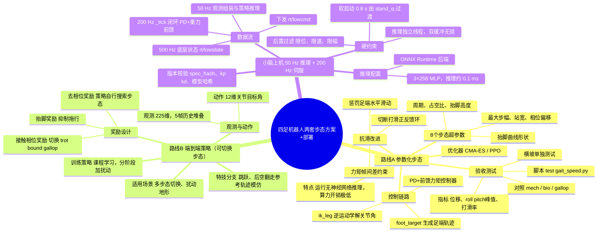

## 一、前提：手写步态的局限

控制器由相位驱动：一个周期内每腿分支撑相与摆动相，支撑相足端按速度反向平移，摆动相按「快抬慢落」曲线抬落，足端目标经 IK 解为 12 个关节角，叠加 PD 与重力前馈后发到 `rt/lowcmd`。参数由人工枚举确定，`mech`、`bio`、`gallop` 三套即由此得到。

仿真实测边界：


| 条件          | 结果                                        |
| ------------- | ------------------------------------------- |
| 0.20 m/s 平地 | 10 s 稳，pitch −2°、roll ±1°、dy ±1 cm |
| 0.30 m/s 平地 | 约 5 s 后失速，vt 0.23 → 0.00，打滑累积    |
| 5° 横坡      | 8 s 不翻，横移 94 cm，roll 峰峰 31°        |

三项未解决：0.30 m/s 以上足端打滑；5° 横坡横向漂移，8 s 横移 94 cm；支撑相法向力由支撑权重按比例分配，未由接触约束求解。三者均发生在足端接触面。接触模型精度不足时，参数只能逐组实验枚举。

强化学习可在千万量级采样内，搜索相位与足端速度的对应关系。

## 二、两个思路

「拿到新步态或新动作」需要的是**运动本身**。它可以只是一组参数，或一条时间轨迹，不需要神经网络上机。

「生成小脑权重，用推理操控机器人」需要的是**控制律**。一个网络输入观测、输出关节目标，替换的是 `_gait_feet_publish`、IK、前馈这条链。

## 三、训练环境不能接现有那条 DDS 链路

> 1. 现状：仿真（mjpython）与控制器是两个独立进程，通过 DDS 收发数据；控制器闭环固定 200 Hz，单帧预算 5 ms。该链路面向真机实时控制，优先保证时序对齐与稳定性。
> 2. RL 训练需求：小脑策略收敛约需 1e8 量级环境样本。
> 3. 冲突：DDS 双进程链路的采样率上限约 200 样本/秒，与训练需求相差 3 个数量级。
> 4. 结论：**训练不使用现有 DDS 闭环。** 训练侧另建同进程、向量化并行的 MuJoCo 环境，不经 DDS，直接推进物理并采样；训练完成后导出权重，接入原 200 Hz 控制器做在线推理。训练与推理是两条独立管线。

训练环境必须进进程内：`mujoco.MjModel` 直接加载 `go2.xml` 并推进物理，新建 `quadruped/rl/env.py`，与 `controller.py` 不互相 import。

硬约束三条。

**机器人模型统一使用项目内这份 `go2.xml`。** RL 训练与仿真验证均加载它，不为适配其他训练框架另行导出 URDF（Unified Robot Description Format，统一机器人描述格式）。`go2.xml` 为 MJCF 格式，经 URDF 往返转换会引入质量与惯量偏差；质量偏差 1 kg 对应重力前馈力矩偏差约 10 N。该类偏差在仿真中不暴露，策略在仿真内表现正常，部署到实机后出现失控、打滑、摔倒。

**顺序合同写在一处。** 项目内存在 `CTRL_LEGS`、`LEGS`、`MOTOR_LEGS` 三套关节排列顺序。训练侧的观测拼接与动作解析、部署侧的观测组装与指令下发，统一 import `spec.py` 读取顺序定义，不在任一侧硬编码；索引错位会导致四肢动作错乱。

**观测不使用 rpy。** RL 观测输入不使用欧拉角（横滚、俯仰、偏航），改用重力矢量在机体坐标系下的三维投影作为姿态特征。横滚接近 ±90° 时欧拉角出现万向锁奇点，数值跳变会破坏观测连续性；重力投影在该位置连续。姿态可用 rpy 计算，但不送入网络。

欧拉角存在万向锁奇点：姿态连续变化时数值可能跳变，不满足网络对观测连续性的要求。重力投影无此问题。

`spec.py` 的定义如下：

> **整个项目唯一的观测、动作、时序参数定义文件**，训练侧、控制器侧统一导入，保证两边维度、缩放、顺序完全对齐。

```python
# quadruped/rl/spec.py —— 观测与动作的定义只有这一份
OBS_ITEMS = (
    ("gyro",      3, 0.25),   # 机体系角速度 rad/s
    ("grav",      3, 1.00),   # R^T · [0,0,-1]
    ("cmd",       3, 1.00),   # vx, vy, wz
    ("q_err",    12, 1.00),   # q - STAND_Q，顺序 CTRL_LEGS
    ("dq",       12, 0.05),
    ("act_prev", 12, 1.00),   # 上一帧动作，压抖动
)
HIST = 5                                  # 堆 5 帧，对抗延迟
OBS_DIM = sum(n for _, n, _ in OBS_ITEMS) * HIST   # 45 × 5 = 225

ACTION_SCALE = 0.25                       # q_target = STAND_Q + 0.25 · a
CTRL_DT = 0.02                            # policy 50 Hz
PHYS_DT = 0.002                           # 物理 500 Hz，decimation 10
```

> 1. **缩放系数（第三个数字）**：将不同量级的观测缩放到相近区间，便于网络收敛；角速度 gyro 量级较大，乘 0.25。
> 2. **`grav` 重力投影**：替代欧拉角的姿态特征，3 维，无万向锁奇点。
> 3. **`q_err` 关节误差**：当前关节角减默认站姿 `STAND_Q`。网络学习相对站立姿态的偏移量，不学习绝对角度。
> 4. **`act_prev` 上一帧动作**：向网络提供上一轮输出，抑制相邻帧动作跳变与关节抖动。
> 5. **HIST=5 观测堆叠**：单帧输入不含延迟信息；堆叠连续 5 帧可提供状态变化趋势。
> 6. **decimation=10**：物理步进 500 Hz，策略无需逐步推理；每 10 个物理步推一次策略，兼顾精度与吞吐。
> 7. **`ACTION_SCALE`**：网络输出 a 取值约 [−1, 1]，乘 0.25 后叠加站立基准角得到关节目标，限制单帧动作幅度。

训练环境的执行器需自行实现，不使用 xml 内置的 position actuator：

> `position actuator`：MJCF (xml) 内置的位置型执行器，MuJoCo 自带的位置伺服。
>
> **不依赖 xml 内写死的位置伺服**，在仿真代码中手写 PD 力矩控制，保证仿真 PD 与真机电机 PD 一致。

```python
tau = kp * (q_des - q) + kd * (0.0 - dq)      # kp=100, kd=1.5，与真机同源
data.ctrl[:] = tau
```

> * `tau`：关节输出力矩（torque）
> * `kp`：比例增益（刚度），`kd`：微分增益（阻尼）
> * `q_des`：目标关节角度；`q`：当前关节角度；`q_des - q` 为角度误差
> * `dq`：当前关节角速度；`0.0 - dq` 表示目标角速度取零，仅做阻尼
> * 即 **PD 力矩伺服**：按角度误差计算力矩，赋值给 MuJoCo 控制输入 `data.ctrl`

kp = 100、kd = 1.5 为本机真机标定值（`KP_REAL`、`KD_REAL`）。若沿用常见教程的 kp = 20、kd = 0.5，仿真伺服刚度显著低于真机，策略会依赖该柔顺特性；部署到真机后伺服刚度更高，表现为抬腿力矩不足、动作失效。

## 四、路线 A：让 RL 去搜步态参数

该方案将动作空间压缩为 8 个步态超参数：周期（步态循环总时长）、占空比（支撑相占周期比例）、抬脚高度（摆动相足端最大离地高度）、最大步幅（单腿前后最大迈步距离）、站宽（左右两腿横向间距）、四腿相位偏移（四腿迈步时刻差）、抬脚曲线形状（摆动相足端轨迹轮廓）。

优化器用 CMA-ES（无梯度黑盒优化）或 PPO，在 8 维空间内搜索；收敛判据为指标不再提升，输出一组 `GaitParams`（步态参数结构体）。

运行时由 `foot_target()` 生成足端轨迹，`ik_leg()` 解算关节角，送入带前馈的 PD 控制器。推理阶段无网络前向，计算开销可忽略。

> 1. **参数化步态**：不直接输出关节角度，用少量参数定义足端轨迹的生成规则。
> 2. **动作空间**：智能体可调整的变量集合。本方案为 8 个步态参数，区别于 12 维关节角的高维动作空间。
> 3. **周期**：一次完整步态循环的总时间。
> 4. **占空比**：支撑相（足端着地）占整个步态周期的比例，决定抬腿时间长短。
> 5. **抬脚高度**：摆动相足端离地的最大高度。
> 6. **最大步幅**：单腿一次迈步前后方向的最大位移。
> 7. **站宽**：左右两腿之间的横向距离，影响侧向稳定性。
> 8. **四腿相位偏移**：四腿时序的错开量，决定步态模式（小跑、爬行等）。
> 9. **抬脚曲线形状**：摆动相足端轨迹的插值轮廓（正弦、贝塞尔曲线等）。
> 10. **`foot_target()`**：步态生成函数，输入步态参数，输出每一时刻的足端期望三维位置。
> 11. **`ik_leg()` 逆运动学**：已知足端目标位置，反解各关节目标角。
> 12. **PD 控制**：比例-微分伺服，按角度误差与误差变化率计算关节力矩。
> 13. **前馈**：按目标轨迹提前补偿力矩，提升跟踪速度、减小滞后。
> 14. **CMA-ES**：协方差矩阵自适应进化策略，无梯度黑盒优化算法。
> 15. **PPO**：近端策略优化，可在低维参数空间做策略搜索。
> 16. **收敛**：指标（稳定性、速度）不再明显提升，参数趋于稳定。
> 17. **`GaitParams`**：存放整套步态参数的数据结构。
> 18. **`make_gait()`**：步态生成入口函数，接收 `GaitParams`，输出足端轨迹。
> 19. **回归成本为零**：运行时只做参数化公式计算，无网络推理开销。

奖励函数如下：


| 项             | 形式                            | 权重 |
| -------------- | ------------------------------- | ---- |
| 前进速度跟踪   | `exp(-(vx - vx_cmd)**2 / 0.04)` | 1.5  |
| 横向、偏航漂移 | `-(abs(vy) + abs(wz))`          | 0.5  |
| 姿态           | `-(roll**2 + pitch**2)`         | 0.6  |
| 机身高度       | `-(h - 0.27)**2 / 1e-3`         | 0.3  |
| 足端打滑       | 支撑相足端水平速度平方          | 0.8  |
| 关节力矩       | `sum(abs(tau))`                 | 1e-3 |
| 力矩帧间差     | `sum(abs(tau_t - tau_prev))`    | 1e-4 |

该方案针对打滑问题。0.30 m/s 时形成「足端打滑 → 速度环增大步幅 → 足端水平速度升高 → 打滑加剧」的正反馈；奖励中对支撑相足端水平速度平方项加权，用于切断该回路。力矩帧间差项与 `_slew_tau` 的限幅滤波作用一致，此处交由优化器权衡。

验收使用 `test/gait_speed.py`：对比位移、roll/pitch 峰峰、打滑率，与 `mech`、`bio`、`gallop` 基准对照。横坡工况单独测试，当前横移 94 cm。

优化目标不限于产生新步态；仅提升抗滑能力同样计为通过。人工枚举 duty（占空比）、站宽等参数以天计，自动搜索可缩短至小时量级。

## 五、路线 B：学一个会换步态的策略

端到端策略的动作空间为 12 维关节目标角。

观测 225 维，即 `spec.py` 所列六项堆叠 5 帧。动作 `a ∈ R¹²`，`q_target = STAND_Q + 0.25·a`（以站立基准姿态叠加缩放后的策略输出），再 clip 到关节限位（后腿大腿用 `LIMITS_REAR_THIGH`，前限更宽）。

奖励在路线 A 基础上增加两项。

**抬脚项。** 仅给前进奖励时，策略收敛到足端不离地、依靠摩擦位移的解：速度指标可达标，姿态误差超限。奖励中加入摆动相离地高度与腾空时间项，约束足端轨迹，强制抬腿。

**接触序列项。** 指定步态通过目标接触相位加入奖励：

```
r_contact = -sum(abs(c_i - c_hat_i) for i in range(4))
```

`c_hat` 由内部时钟给出：对角相位为 trot（对角小跑），前后两对为 bound（弹跳步态），四腿错相为 gallop（疾驰步态）。同一奖励函数更换相位模板即可切换步态目标，与 `make_gait` 的三档对应。若希望策略自行搜索步态，可去掉该项、仅保留抬脚约束；代价是收敛变慢，且更易陷入局部最优（异常步态）。

课程学习（分阶段训练）为必需项：指令速度从 0 起，站立保持 5 s 后按 0.1 m/s 递增；平地通过后加入 ±2 cm 起伏与摩擦随机；最后加侧向推力。直接从 0.6 m/s 训练时，前期样本几乎全部终止于摔倒，难以收敛。

**跳跃、后空翻等动作单独处理。** 从零搜索奖励的样本成本过高，改用参考轨迹加模仿奖励：`pose_sequence` 已提供关键帧插值，将关键帧扩展为带时间戳的参考轨迹，网络学习跟踪；落地缓冲单独设奖励项。`peak_z` 可直接用于测量腾空高度。

## 六、小脑上机：50 Hz 出目标，200 Hz 执行

部署链路与全篇结构：



策略 50 Hz 输出目标，200 Hz 回路执行插值、限速、PD 与前馈。

**推理不进主回路。** `embodied/__init__.py` 已记录该约束：单次推理为百毫秒量级，在回路内同步等待会导致丢帧、腿悬空。策略在独立线程推理，与伺服线程解耦；`_tick` 通过引用赋值的双缓冲读取最新目标（两块缓冲区，一块写入新输出、一块供回路读取，单写单读无需加锁）。若将策略置于独立进程，可复用 `launcher.py` 的多进程模型。

**软启动。** 由 `stand_q`（站立基准姿态）经 0.8 s 插值过渡到策略输出。`_tau_ff` 中 `TAU_ARM_ERR` 的斜降逻辑处理同一问题：实际关节角与目标偏差较大时，前馈需按比例退让，否则前馈力矩方向与目标轨迹不一致，产生反向冲击。

**后置过滤。** 策略输出先过三道处理：关节限位 clip（截断到硬件允许角度范围）、关节角每帧限速（0.05 rad/帧，200 Hz 下等于 10 rad/s）、力矩限幅（限制最大输出力矩）。`selftest()` 与 `_check_*` 系列校验全部保留。

```
# mode == "policy" 时 _tick 里做的事
tgt = self._policy_target if self._policy_target is not None else self._hold_q
tgt = np.clip(tgt, self._q_lo, self._q_hi) # 关节角度限位裁剪
tgt = self._slew_q(tgt, step=0.05) # 角度斜率限速，平滑突变
self._publish(tgt, tau=self._tau_ff(tgt)) # 下发目标角度+前馈力矩
```

推理后端使用 ONNX Runtime 即可。三层 256 的 MLP，前向耗时 0.1 ms 以内，Go2 机载算力足够；实际瓶颈在 Python GIL 与线程调度，不在网络计算量。

权重文件内需保存三项：`spec_hash`（观测配置哈希，标记观测空间定义版本）、`kp/kd`（PD 增益）、`go2.xml` 的 hash（MJCF 模型文件哈希）。

观测向量任一字段变更后，旧权重必须废弃：输入通道语义与归一化统计量均不再匹配，策略映射关系失效。

## 七、sim2real 清单


| 项       | 范围                            | 说明                         |
| -------- | ------------------------------- | ---------------------------- |
| 机身质量 | ±10%                           | 加负载、换电池均会变化       |
| 地面摩擦 | 0.4 ～ 1.2                      | 瓷砖、地毯、水泥差异显著     |
| 电机强度 | ±15%                           | 电池电压从 32 V 降至 28 V    |
| 控制延迟 | 1 ～ 3 帧                       | DDS 与驱动器合计，按 5～15 ms 估 |
| IMU 噪声 | 陀螺 0.02 rad/s、加计 0.2 m/s² | 起点值，用真机静置数据标定   |
| 地形     | 摩擦随机 + ±2 cm 起伏          | 5° 坡工况单独验证           |
| 观测噪声 | 关节角 0.01 rad、角速度 0.5     | 训练时加入，推理时不加       |

名义值直接读取 `simulate_python/config.py` 中的 `REALISM`。该配置已包含关节摩擦、力矩输出带宽、编码器噪声与指令延迟模型；将固定值改为参数化随机采样即得到域随机化。

释放 mcf 后，策略是唯一的平衡层。`ReleaseMode` 启用时，宇树原生第二层 MPC + WBC 链路停止工作；站立静差由 4.12° 降至 0.64° 是重新整定参数的结果。策略须独立保证站立稳定，不依赖底层运控的平衡回路。

## 八、算力：Mac 上没有 CUDA


| 方案                         | 可行性   | 说明                                                                            |
| ---------------------------- | -------- | ------------------------------------------------------------------------------- |
| Isaac Lab / legged_gym 本地  | 不可行   | 依赖 NVIDIA GPU 与 Linux                                                        |
| MJX 本地（mujoco-mjx + JAX） | 可用，吞吐低 | 与 `go2.xml` 同一份模型，Python 3.10 兼容，Apple Silicon 走 CPU，百万步约需一夜 |
| 租 GPU 跑 MJX 或 Isaac Lab   | 推荐     | 4090 上一亿步约 1～2 小时，权重取回 Mac 做推理验证                             |

路线 A 搜索空间小，本地可完成。路线 B 需租用 GPU 训练，导出 ONNX 后在仿真器 DDS 链路上验证同一份权重，再部署到真机。

前置检查：`unitree_mujoco` 克隆已在盘上，`unitree_robots/go2/scene.xml` 可加载（nq/nv/nu = 19/18/12，总质量 15.206 kg），`MODEL_PATH` 指向的 `go2.xml` 可解析。该目录被 `.gitignore` 排除，但我们在里面改过桥的真机化（延迟/噪声/带宽）与 `go2.xml` 的关节阻尼、足底摩擦，这两处改动以 patch 存在 `quadruped/sim/patches/`，**重新 clone 会全部冲掉**，恢复步骤见该目录 README。

## 九、施工顺序


| 阶段 | 产出                       | 验收                                                                | 估时    |
| ---- | -------------------------- | ------------------------------------------------------------------- | ------- |
| 0    | `rl/spec.py` + `rl/env.py` | 500 Hz 物理 / 50 Hz 控制，reset 后靠 `STAND_Q` 站住，随机动作不 NaN | 1～2 天 |
| 1    | 路线 A：参数搜索           | 平地 0.3 m/s 不打滑，5° 坡横移减半                                 | 3～5 天 |
| 2    | 路线 B：命令跟踪策略       | 仿真 0 ～ 0.6 m/s、转向、侧推 10 s 不摔                             | 1～2 周 |
| 3    | `rl/deploy.py`             | 仿真器 DDS 链路上跑同一份权重，观测与训练环境逐位对齐               | 1 周    |
| 4    | 真机验证                   | 吊起 → 趴姿软启动 → 站立 10 s 比对 `tau_est` → 0.15 m/s          | 待定    |

> 第 3 阶段的逐位对齐需落为断言：对同一帧原始传感数据（IMU、关节角等），训练环境与部署链路各自计算观测向量，两份结果必须逐元素相等。
>
> 误差多来自缩放系数。典型表现为部署后策略输出动作幅度整体偏小，即输出力矩不足。

## 十、常见错误与约束

1. **关节顺序**：观测拼接与动作还原的排布顺序必须与 `CTRL_LEGS` 一致。三处定义错一处即表现为左右腿指令互换、步态相位偏移半周期；该现象易被误判为参数问题。
2. **不在 200 Hz 回路内等待推理**：`loop_stats()` 的 p95 门限为 4 ms。在伺服循环内同步等待推理会超出单帧预算，造成丢帧。
3. **kp/kd 与执行器带宽同源**：仿真训练使用的 kp、kd 与真机部署须完全一致；更换该组参数后模型需重训。执行器带宽指电机力矩响应速度上限。
4. **缺抬脚项会收敛到拖行**：奖励缺少离地高度或腾空时间项时，策略收敛到足端持续贴地滑移。当前 0.30 m/s 打滑属同类缺陷，需补充该项。
5. **权重与 spec 绑定**：观测字段或归一化系数任一变更，旧权重即失效。`checkpoint` 内保存配置哈希，用于版本一致性校验。

## 十一、和 MPC/WBC 那条线的关系

1. RL 与 MPC + WBC 两条链路可共存，输出目标不要求一致。路线 A 搜索得到的步态参数与参考轨迹，可直接作为 SRBD-MPC（单刚体模型预测控制器）的输入：接触序列、落脚点、参考速度。
2. WBC 可作为策略输出的安全层，在力矩层拦截危险动作，效果优于仅在关节角层面做 clip。
3. 原有 MPC 链路（动力学模型 → MPC → WBC → 驱动接线 → 真机）架构不变，RL 代码在 `quadruped/rl/` 独立开发。两边仅共用 `model.py` 的几何与质量参数及 `go2.xml`（MJCF 模型文件），不维护第二份机身描述。
